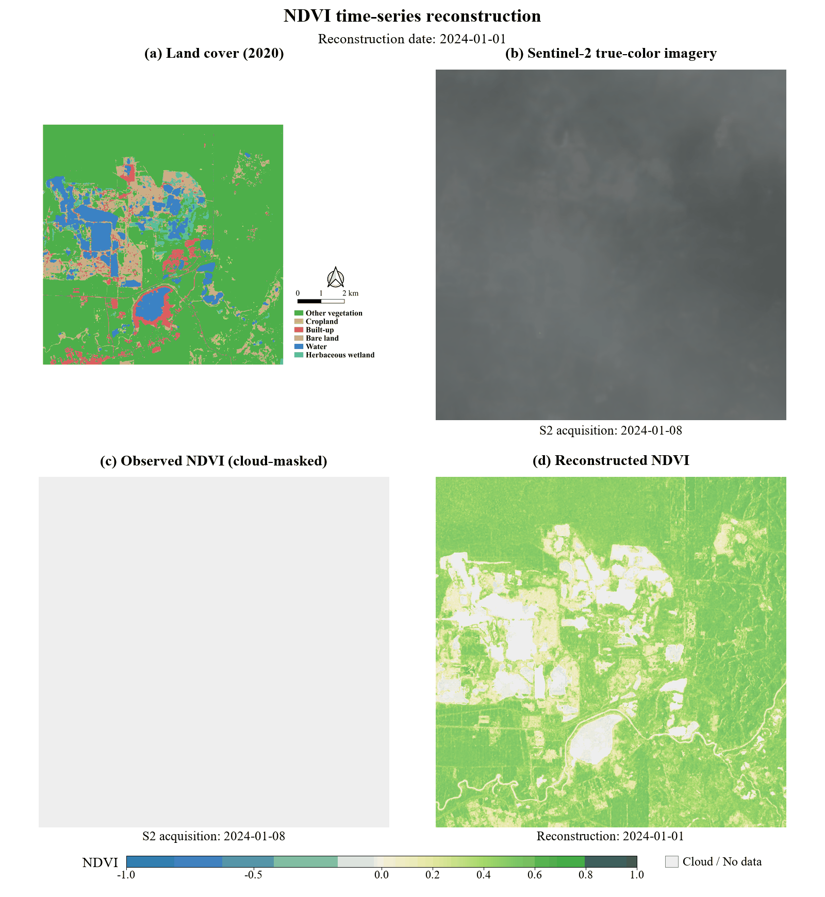
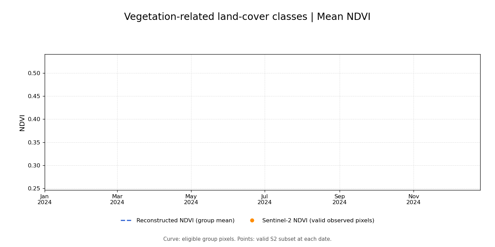

# STReF-NDVI

**Spatio-Temporal SAR–Optical Fusion Framework for Reconstructing NDVI Time Series under Persistent Cloud Cover**

STReF-NDVI reconstructs 10 m NDVI time series under persistent cloud cover
using Sentinel-1 SAR observations and quality-controlled Sentinel-2
NDVI supervision.

This repository provides workflow overviews, demonstration data, a
corresponding pretrained model checkpoint, and scripts for NDVI
reconstruction, evaluation, and visualization.

**The complete model development and training implementation is not
included in this public release.**

## Publication

**STReF-NDVI: A spatio-temporal SAR-optical fusion framework for
reconstructing NDVI time series under persistent cloud cover**

*Information Fusion*, 2026, Article 104760.

**DOI:** https://doi.org/10.1016/j.inffus.2026.104760

## Framework Overview

The framework uses SAR observations to estimate vegetation dynamics
during periods with limited optical observations. Available Sentinel-2
NDVI observations provide quality-controlled reference labels.

The architecture and experimental methodology are described in the paper.

## Repository Contents

| File | Description |
| --- | --- |
| `01_Dataset_Construction_Overview.md` | Describes the input data, temporal organization, dataset outputs, and conceptual data construction workflow. |
| `02_STReF-NDVI_training_overview.md` | Provides a conceptual overview and pseudocode of the training workflow. |
| `03_NDVI_Reconstruction.py` | Contains the NDVI reconstruction and prediction export workflow. |
| `04_Evaluation_Dataset_Construction.py` | Prepares evaluation coordinates from valid optical reference observations. |
| `05_Evaluation.py` | Calculates R², RMSE, and MAE at supplied evaluation coordinates and generates diagnostic plots. |

The two overview documents describe the processing logic and are
**not executable Python scripts**.

## Demonstration Data and Pretrained Model

**The demonstration dataset and its corresponding trained model
checkpoint are available on the
[GitHub Releases page](https://github.com/Madao97/STReF-NDVI/releases/tag/v1.0.0).**

The released materials support examination of the sample data,
model application workflow, and reconstruction results over the
demonstration area. They do not constitute the complete dataset or
training pipeline used for all experiments in the paper.

Use the checkpoint with its corresponding data configuration.
Input channel order, normalization, temporal information, and model
configuration must remain compatible with those used during training.

A parameter-only checkpoint requires a compatible model definition
or an appropriate exported inference model; the checkpoint alone is
not a standalone executable.

## Data Organization

The dataset follows the Sentinel-1 observation dates recorded in the
matching table. Available Sentinel-2 observations provide NDVI reference
labels. Sentinel-1 dates remain in the sequence when no valid optical
supervision is available.

The dataset construction workflow produces the following files.
Refer to the release assets for the files included in the demonstration package.

| File | Shape | Description |
| --- | --- | --- |
| `S1.npy` | `(T, 5, H, W)` | Normalized Sentinel-1 feature sequences |
| `S2.npy` | `(T, H, W, 3)` | NDVI, cloud mask, and water mask |
| `target_mask.npy` | `(T, H, W)` | Valid optical supervision mask |
| `S1_valid.npy` | `(T, H, W)` | SAR validity flags from preprocessing |
| `good_pixel.npy` | `(H, W)` | Pixels eligible for supervised sampling |
| `dates.csv` | — | SAR observation dates and associated optical label dates |
| `metadata.json` | — | Dataset dimensions, channel order, dates, and processing metadata |
| `normalization.pkl` | — | SAR normalization parameters |

Here, `T` is the number of temporal observations, and `H` and `W`
are the spatial dimensions.

### Data Usage Notes

- Check the metadata before using the data with a model.
- The supplied normalized SAR arrays should not be normalized again.
- Missing optical labels must not be interpreted as zero NDVI.
- Cloud and water masks use zero for clear and non-water pixels,
  respectively.
- Use `target_mask.npy` to identify valid optical reference labels.
- Use the recorded optical acquisition dates when interpreting
  comparisons between observations and predictions.
- A supervision mask identifies usable reference observations;
  it does not, by itself, define an independent test set.

## Preprocessing and Training Scope

The original workflow starts from preprocessed and spatially aligned
Sentinel-1 imagery, Sentinel-2 NDVI observations, cloud and shadow masks,
water masks, and a temporal matching table.

Satellite data acquisition, sensor-specific preprocessing, temporal
matching, and the full training implementation are outside the scope
of this public release. The overview documents explain how the inputs
and outputs relate to the reconstruction workflow.

For the complete methodology, preprocessing criteria, and experimental
protocol, please refer to the published paper.

## Example Results

### Spatial NDVI Reconstruction

The animation compares Sentinel-2 true-color imagery, cloud-masked
NDVI observations, and reconstructed NDVI over a demonstration area.
A fixed land-cover map provides spatial context.

Observed and reconstructed NDVI share the same color scale.
Displayed dates identify the acquisition or reconstruction times
and any temporal differences between panels.

### Mean NDVI over Vegetation-Related Land-Cover Classes

The animation compares mean reconstructed NDVI with available
Sentinel-2 observations across other vegetation, cropland, and
herbaceous wetland in the demonstration area.

The reconstructed curve represents eligible pixels across these classes.
Observation points represent valid Sentinel-2 pixels at each accepted
date, so their spatial coverage may vary over time.

These animations illustrate reconstruction results and temporal variation
in the demonstration area. They do not replace the quantitative
evaluation reported in the paper.

## Software Requirements

The Python workflows use NumPy, pandas, Rasterio, PyTorch,
PyTorch Geometric, scikit-learn, and other dependencies listed in
`requirements.txt`.

Install PyTorch and PyTorch Geometric versions compatible with
your hardware and model environment:

- [PyTorch installation instructions](https://pytorch.org/get-started/locally/)
- [PyTorch Geometric installation instructions](https://pytorch-geometric.readthedocs.io/en/latest/notes/installation.html)

The overview documents can be read directly on GitHub and do not
require a Python environment.
